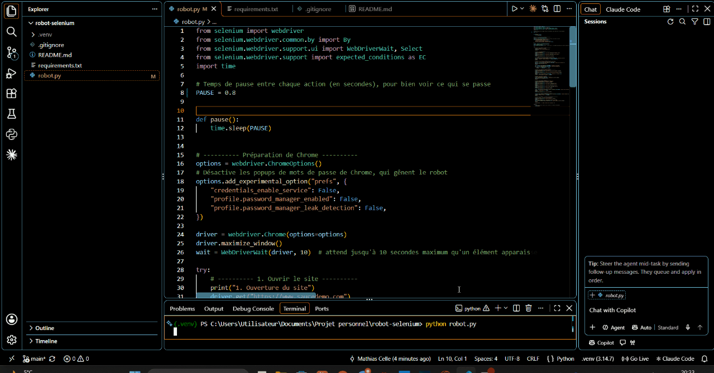

# Robot Selenium : test automatisé d'un parcours d'achat

Test automatisé écrit en **Python** avec **Selenium**. Il pilote Google Chrome pour réaliser tout seul un parcours d'achat complet sur le site de démonstration [saucedemo.com](https://www.saucedemo.com), en vérifiant à chaque étape que tout fonctionne correctement.



## Ce que fait le test

Le robot réalise un parcours d'achat complet et **vérifie automatiquement 11 points** :

| Étape | Vérification |
|---|---|
| Ouverture | Le site est bien chargé |
| Connexion | Arrivée sur la page produits, les 6 produits sont affichés |
| Tri | Les prix sont bien classés du moins cher au plus cher |
| Panier | Le compteur affiche 2 articles, les 2 bons produits sont présents |
| Commande | Le montant affiché correspond au total **recalculé par le robot** |
| Confirmation | Le message de confirmation s'affiche, le panier est vidé |
| Déconnexion | Retour à la page de connexion |

À la fin, le test affiche **TEST RÉUSSI** ou **TEST ÉCHOUÉ**. En cas d'échec, une **capture d'écran** de la page est enregistrée automatiquement (`erreur.png`) pour faciliter le diagnostic.

### Exemple de résultat dans le terminal

```
1. Ouverture du site
   ✅ Le site est bien ouvert
2. Connexion
   ✅ On est sur la page des produits
   ✅ Les 6 produits sont affichés
3. Tri des produits du moins cher au plus cher
   Prix affichés : [7.99, 9.99, 15.99, 15.99, 29.99, 49.99]
   ✅ Les prix sont bien triés du moins cher au plus cher
...
✅ TEST RÉUSSI : 11 vérifications réussies
```

## Technologies utilisées

- **Python 3**
- **Selenium 4** : pilotage du navigateur, recherche d'éléments (`By.ID`, `By.CLASS_NAME`), attentes explicites (`WebDriverWait`), menus déroulants (`Select`), captures d'écran
- Gestion des erreurs (`try` / `except` / `finally`) et code de sortie pour l'intégration continue

## Points techniques

- **Attentes explicites plutôt que pauses fixes** : le robot attend qu'un élément soit réellement visible avant d'agir (`WebDriverWait`), ce qui évite les tests qui échouent au hasard quand une page charge lentement. Les pauses (`PAUSE`) ne servent qu'à rendre la démonstration lisible ; avec `PAUSE = 0`, le test tourne à pleine vitesse.
- **Vérification indépendante des montants** : le total n'est pas recopié depuis la page, il est recalculé à partir des prix du panier puis comparé à celui affiché par le site. Une erreur de calcul du site serait donc détectée.
- **Preuve en cas d'échec** : une capture d'écran est prise automatiquement au moment exact du problème.
- **Code de sortie** : le script renvoie `0` en cas de réussite et `1` en cas d'échec, ce qui permet de l'intégrer dans une chaîne d'intégration continue.

## Lancer le projet

Prérequis : Python 3 et Google Chrome installés. Le pilote de Chrome est téléchargé automatiquement par Selenium.

```
git clone https://github.com/Okpsaihtam/robot-selenium.git
cd robot-selenium
python -m venv .venv
.venv\Scripts\activate
pip install -r requirements.txt
python robot.py
```

Une fenêtre Chrome s'ouvre et le robot réalise le parcours tout seul, pendant que le terminal affiche chaque vérification.

> Sous Mac ou Linux, remplacez `.venv\Scripts\activate` par `source .venv/bin/activate`.

## Structure du projet

```
robot-selenium/
├── robot.py           # Le test automatisé
├── requirements.txt   # Bibliothèques nécessaires (Selenium)
├── demo.gif           # Vidéo de démonstration
├── .gitignore         # Fichiers exclus de Git
└── README.md          # Ce fichier
```

## Auteur

**Mathias Celle** - [GitHub](https://github.com/Okpsaihtam)